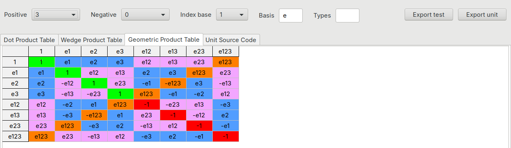

# Clifford

Geometric Algebra (a.k.a. Clifford algebra) package for the Free Pascal
compiler, with a toolkit that generates a ready-to-use unit for any algebra
Cl(p,q) with p + q up to 6.



## Contents

| Unit | Algebra | Basis vectors |
|---|---|---|
| `cl2` | Cl(2,0), 2D Vectorspace geometric algebra | e1, e2 |
| `cl3` | Cl(3,0), 3D Vectorspace geometric algebra | e1, e2, e3 |
| `cl4` | Cl(4,0), 4D Vectorspace geometric algebra | e1 .. e4 |
| `cl13` | Cl(1,3), Spacetime algebra (STA) | g0 .. g3, g0^2 = +1 |

Each unit provides a multivector type, one type per grade (vectors, bivectors,
trivectors...), the basis blades as constants, and the usual operations:
geometric, dot and wedge products (and the cross product in 3D), reverse, involution, conjugate, dual,
norms, inverse, projection, rejection, reflection and rotation.

## Requirements

- Free Pascal 3.2 or later.
- Lazarus, to install the package or to build the toolkit GUI.

The units depend on the Free Pascal RTL only.

## Installation

Install the `clifford.lpk` package in Lazarus, or add the units to your
project.

## Usage

```pascal
uses
  cl3;

var
  a, b, v: TVector;
  R: TMultivector;
begin
  a := 1*e1;
  b := 1*e2;
  v := 2*e1 + 3*e3;
  R := b * a;                        // rotor: twice the angle from a to b
  Writeln(v.Rotation(a, b).ToString);
  Writeln((R * v * R.Inverse).ToString);
end.
```

Spacetime algebra: a Lorentz boost is a rotor too. Here a particle at rest is
boosted to v = 0.6c along g1, and its squared norm (the invariant mass) is
preserved:

```pascal
uses
  Math, cl13;

var
  phi: double;
  p, q: TVector;
  R: TMultivector;
begin
  phi := ArcTanh(0.6);                     // rapidity for v = 0.6c
  p := 1*g0;                               // particle at rest, unit mass
  R := Cosh(phi/2) - Sinh(phi/2)*g01;      // boost rotor along +g1
  q := TVector(R * p * R.Reverse);
  Writeln(q.ToString);                     // +1.25g0 +0.75g1 (gamma, gamma*v)
  Writeln(p.SquaredNorm:0:6, ' ', q.SquaredNorm:0:6);  // 1.000000 1.000000
end.
```

### Conventions

- `Dot` is the "fat" dot product: e_A . e_B = e_A e_B when one index set contains
  the other, 0 otherwise (scalars included).
- `Involute` is the grade involution, `Conjugate` the Clifford conjugate.
- `SquaredNorm` is <X ~X>_0, `Norm` is `Sqrt(Abs(SquaredNorm))`.
- `Dual` is X * I, with I the unit pseudoscalar.
- `Inverse` is the multiplicative inverse: X * X.Inverse = X.Inverse * X = 1.
  Dividing by a non-invertible value raises a floating-point exception.
- `X.Rotation(A, B)` is B A X A⁻¹ B⁻¹, the composition of two reflections: it
  rotates X in the plane A ∧ B by **twice** the angle from A to B. For example,
  with A = e1 and B at 45° from e1 towards e2, e1 is rotated to e2.
- `X.Rotate(R)` is R X ~R, the rotation by the rotor R (R ~R = 1). For a
  rotation by θ in the plane of the unit bivector B, R = cos(θ/2) - sin(θ/2) B.
  The result keeps the type of X: `v.Rotate(R)` is a vector.
- Widening to `TMultivector` is implicit; narrowing (to a k-vector or to
  `double`) is explicit: `TVector(M)`, `double(M)`.
- `Components[...]` reads and writes single coefficients, e.g.
  `B.Components[bc12]`, `M.Components[mc123]`.
- `ToString` writes the non-zero components, e.g. `+2 -1.5e1 +3e3`;
  `ToString(APrecision, ADigits)` sets the number format.

## Toolkit

The [`toolkit/`](toolkit) folder contains the generator of the units, as a GUI
and as a command-line program. Build them with:

```
lazbuild toolkit/clgengui.lpi                  # GUI: toolkit/build/clgengui
lazbuild toolkit/clgen.lpi                     # command line: toolkit/build/clgen
```

### GUI

Choose the number of positive and negative basis vectors, the index base, the
basis prefix and the type prefix. The tabs show the dot, wedge and geometric
product tables, with the cells colored by grade, and the generated source;
*Export unit* saves the unit and *Export test* saves a program that checks it.

### Command line

```
clgen -p <positive> [-q <negative>] [-b <0|1>] [-n <basis prefix>]
      [-x <type prefix>] [-u <unit>] [-o <file>] [-t <test file>]
      [-i <test iterations>]
```

| Option | Meaning | Default |
|---|---|---|
| `-p`, `-q` | number of basis vectors squaring to +1 and to -1 | `-q 0` |
| `-b` | index of the first basis vector | `1` (e1, e2...) |
| `-n` | prefix of the basis names | `e` |
| `-x` | prefix of the type names, inserted after the `T` (`CL3` gives `TCL3Vector`, `TCL3Versor1`...) | none |
| `-u` | unit name | `cl<p>` or `cl<p><q>` |
| `-o` | output file | `<unit>.pas` |
| `-t` | also write a program that checks the unit | none |
| `-i` | iterations of the check program | chosen from the dimension |

Examples:

```
clgen -p 3 -t cl3check.lpr                     # Euclidean 3D space
clgen -p 1 -q 3 -b 0 -n g -u cl13              # spacetime algebra: g0..g3, g0^2 = +1
clgen -p 4 -q 1 -u cga3                        # conformal model of 3D space
```

## Tests

Each unit has a test program and a check program in [`tests/`](tests):

```
lazbuild tests/cl3test.lpi  && tests/build/cl3test
lazbuild tests/cl3check.lpi && tests/build/cl3check
```

## Author

Melchiorre Caruso (melchiorrecaruso@gmail.com)

## References

- C. Doran, A. Lasenby, *Geometric Algebra for Physicists*, Cambridge
  University Press, 2003.
- E. Hitzer, S. Sangwine, *Multivector and multivector matrix inverses in real
  Clifford algebras*, Technical Report CES-534, 2016.
- D. S. Shirokov, *On computing the determinant, other characteristic
  polynomial coefficients, and inverse in Clifford algebras of arbitrary
  dimension*, Computational and Applied Mathematics, 2021.

## License

[MIT License](LICENSE), Copyright (c) 2024-2026 Melchiorre Caruso.
